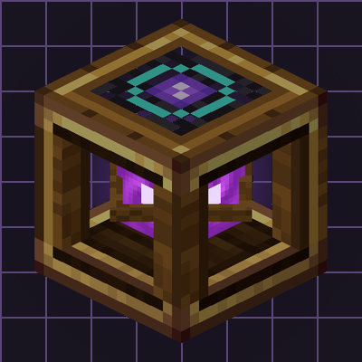
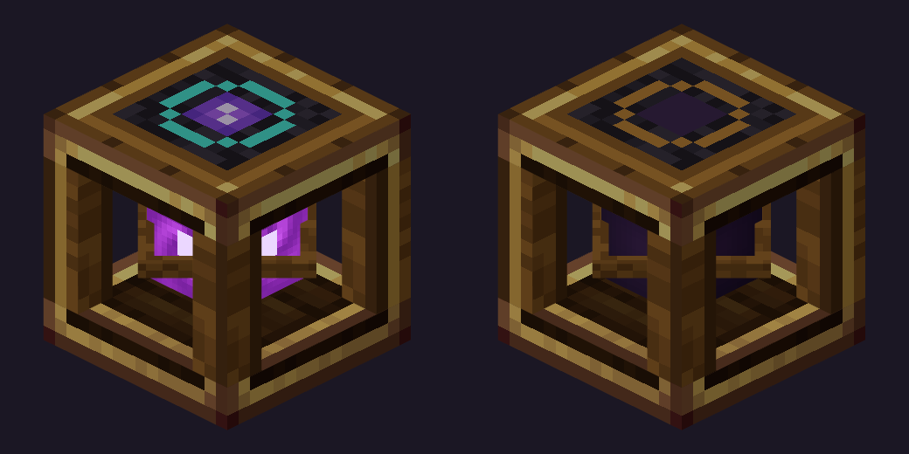

# Create: Brass Anchor

> **AI disclosure:** This mod was created with the help of AI (Claude by Anthropic). The code, textures, 3D model, logo and this description were generated with AI assistance.

**A lightweight chunk loader for Create that keeps your factories, farms and animals running, even on moving trains and Sable ships.**

## Features

- **One block, fully ticking chunks.** Loaded chunks stay in the simulation: Create machines, furnaces, crops (random ticks) and **animals and other entities keep ticking**, even with no player nearby.
- **Adjustable radius.** Right-click to cycle from 1×1 up to 5×5 chunks (configurable up to 17×17). Sneak + right-click shows the status.
- **Redstone off switch.** A redstone signal releases the chunks, so farms only run when you want them to.
- **Create contraptions and trains.** Put an anchor on a bearing, piston, minecart contraption or train and the loaded area follows it. The next chunk is loaded before the contraption arrives.
- **Sable ships (optional).** An anchor on a Sable ship (e.g. Create: Aeronautics) keeps the ship loaded through Sable's own ticket system, also across server restarts, and loads the surroundings in the chosen radius.
- **Engineer's Goggles** show status and loading area.
- **Admin tools.** `/brassanchor list` shows anchors and loaded chunks per dimension. Server config for maximum radius and an optional per-dimension anchor limit.

## Why it is light on performance

- A placed anchor **never ticks**. It registers NeoForge chunk tickets once when placed or changed and removes them when broken.
- Ticket changes are applied **as a diff**: only chunks that actually enter or leave the area are touched.
- Moving anchors only update when they **cross a chunk border**.
- No natural mob spawning in anchored chunks (vanilla only spawns near players), so no mob pile-ups.
- Orphaned tickets (e.g. after a crash) are cleaned up on world load.

## Recipe

| | | |
|---|---|---|
| Brass Ingot | Eye of Ender | Brass Ingot |
| Obsidian | Brass Casing | Obsidian |
| Brass Ingot | Precision Mechanism | Brass Ingot |

## Requirements

- Minecraft 1.21.1, NeoForge 21.1.219 or newer
- [Create](https://www.curseforge.com/minecraft/mc-mods/create) 6.0.10 or newer (required)
- [Sable](https://www.curseforge.com/minecraft/mc-mods/sable) 2.0.6 or newer (optional)

Install on both client and server.

## Links

- Source code and issues: https://github.com/Blaublue1303/brass_anchor_create
- License: MIT
- Made with AI assistance (Claude by Anthropic): code, textures, 3D model and logo.
